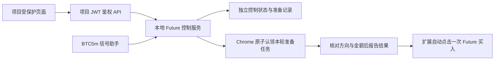

# Future BTC5m Bridge 控制页面

2026-10-11。用户已确认每笔金额为平台 **1 美元**，最初选择“自动准备票据，我最终买入”。扩展 0.4.0 起，用户选择让同一开关同时启用自动买入：项目开关控制 `PREPARE_ONLY` 准备，扩展比较本轮 Future 涨/跌按钮数字，选择较大的一方并填写 $1，READY 后由扩展自动点击一次 Future 买入。服务器交易执行器仍未连接。

## 页面与状态

登录项目后，从侧栏 **Future BTC 5 分钟** 进入 `/future-btc5m-bridge`。

- 固定 BTC 5 分钟、每笔本金 $1；页面不能改变金额或周期。
- 自动准备票据开关保存 `requestedEnabled`，独立关停按钮始终保留。服务器确认后更新开关，失败显示“状态未知”，不会把超时当作关闭成功。
- `preparation` 单独报告准备状态与最后一次准备事实；`READY` 表示本轮方向与 $1 已回读确认，不能证明提交或成交。历史记录不能作为当前准备许可。
- `effectiveEnabled` 与 `executorReady` 均为 `false`；它们仍表示实际交易执行，不能用准备成功替代。
- 每 5 秒刷新状态和订单；15 秒没有新状态显示过期。冻结采样超过 5 秒、超过 +80 秒或轮次不符时，不显示可用于入场的方向。
- 订单列表支持状态筛选、分页和详情抽屉。详情包含轮次、方向、本金、执行事件、平台订单号、实际成交量、均价、费用及提交/成交时间；未知值显示 `—`。

与现有 Bridge 相同，区分信号处理、提交和成交事实。Future 配置与记录单独保存，不写入现有 Bridge 订单表，不复用其浏览器交易队列。

## 链路与接口



项目 API 使用现有 `ApiResponse`，全部要求 JWT：

| 方法与路径 | 请求 |
|---|---|
| `POST /api/future-btc5m/status` | `{}` |
| `POST /api/future-btc5m/control` | 仅 `{"enabled":true/false}` |
| `POST /api/future-btc5m/orders/list` | `{"page":1,"size":20,"status":"SKIPPED"}`，status 可省略 |
| `POST /api/future-btc5m/orders/detail` | `{"id":"future-btc5m:<轮次秒数>"}` |

后端配置项 `future.bridge.url`，默认 `http://127.0.0.1:8766`，可通过 Spring 配置 `FUTURE_BRIDGE_URL` 设置。后端只访问配置的固定桥地址，不转发用户 JWT，不接受调用者提供 URL。响应需通过身份、固定金额、状态一致性、列表及订单事实校验；空响应和无法确认的开关结果都报失败。

本地助手新增 `GET /bridge/status`、`POST /bridge/control`、`GET /bridge/orders`、`GET /bridge/orders/<id>`。控制请求要求专用头 `X-PolyHermes-Future-Control: 1`、严格布尔 JSON、正确本机 Host，并拒绝带 Origin 的浏览器直连；不提供 CORS。现有 `/status`、`/draft` 保持原语义，没有交易提交端点。

## 运行与记录

```bash
cd /Users/henry/projects/polyhermes
scripts/future-btc5m-runtime/.venv/bin/python scripts/future_btc5m_assistant.py --watch
```

辅助服务监听 `127.0.0.1:8766`。控制状态为 `reports/future-btc5m-assistant/bridge/control.json`，实际订单历史为同目录 `orders.jsonl`，准备事件为独立 `preparations.jsonl`，扩展点击审计为 `buy_attempts.jsonl`（见 [自动买入](future-btc5m-buy-once.md#审计与回测)）。重启强制关闭开关，撤销未完成准备并保留历史；STOP 自动取消启用请求。准备账本损坏或写盘失败阻断新准备，不改变旧订单事实。

仅开启请求后，新的有效信号及新鲜本轮浏览器票据可生成准备任务：BTC5m 正确轮次、+60 至 +80 秒、新鲜 Chainlink 样本及 60 秒 TWAP 基准。启用前样本不补录，每轮去重一次。旧 `SKIPPED / EXECUTOR_NOT_CONNECTED` 订单历史保留；准备流程不会新增跳过订单或制造提交、成交、平台订单号及费用。

## 自动准备与自动买入

扩展 0.3.1 使用本机固定 `GET /bridge/preparation`、`POST /bridge/preparation/claim` 和 `POST /bridge/preparation/ack`，要求专用头 `X-PolyHermes-Future-Preparation: 1`。项目页面仍使用原有四个 JWT API；生产 relay 不开放认领和回执接口，准备写入只发生在用户 Mac 的已登录 Chrome。

1. 新准备使用 schema2；服务持久保存本轮 `PENDING`、两个按钮数值、较大方向、`selectionSource=HIGHER_BUTTON_PRICE` 和本机快照接收时间 `quoteObservedAt`，金额固定为 $1，授权来源明确为 `USER_REQUEST`。该授权仅用于准备票据，不将 Future 官方资格 `UNKNOWN` 改为已核实；旧草稿守卫保持原样。
2. 扩展确认 URL、同一票据的完整美东标题、美元市价买入栏及独立方向按钮。只有第一次原子认领返回 200 才可操作；重复认领返回 409。读取到 `CLAIMED`、重新加载或断线恢复均不能补做。
3. 每一步重读服务与票据，服务时差不得超过 3 秒，价格样本不得超过 5 秒，且仍在 +60 至 +80 秒窗口。两个按钮数字和原始按钮快照也需核对，原快照不得超过 5 秒；选择数字较大的一方并写入 1。相同、不可读或较大侧中途改变时停止本轮，没有默认涨回退；准备步骤本身不点击最终买入或触发提交。
4. 回读实际方向、金额与买入按钮状态，先保存只读预检，再提交严格回执。成功记录 `READY`；失败、撤销、过期或回执未知均保留事实，不能重试同轮。
5. 开关开启时，扩展 0.4.0 的 `buy_once.js` 预先监控，只接受监控开始后新生成的本轮 READY，再次核对票据后点击票据内唯一的“买入 涨/跌”，每轮最多一次。点击结果记为未知；助手不读取钱包签名、不发交易请求，不把准备回执或点击尝试当作成交回执。详见 [自动买入](future-btc5m-buy-once.md)。

项目后端需要与此本机服务同机，或通过私有转发抵达对应 loopback 端点。VPS 中的 `127.0.0.1` 指向 VPS，不能直接连接用户 Chrome 所在 Mac。生产连接使用独立 Unix socket SSH 反向隧道和只监听 app 网络 loopback 的 relay；不发布端口、不复制浏览器登录资料，详见 [生产私有连接](future-btc5m-production-transport.md)。

schema1 历史准备按原有规则验证并保留；它不能恢复当前填写许可。旧订单与历史预检不补造按钮数字，新 schema2 预检保留 Chainlink 参考方向并独立记录按钮较大方向。

## 下单前只读预检

当前扩展 0.3.1 保留自 0.2.4 起的只读报告：每秒读取当前 BTC5m 页面的轮次、美元市价买入栏、现有金额、已选方向、两按钮数值及买入按钮状态，仅将严格白名单字段报告到本机 `POST /bridge/preflight`。该接口要求 `X-PolyHermes-Future-Preflight: 1`，仅接受本机或合法 Chrome 扩展 Origin；报告不包含查询参数、DOM 文本、余额、账户标识或凭据。

项目状态中的 `preflight` 持续报告只读事实，票据准备另由自动准备开关控制。只有浏览器报告新鲜、市场和票据属于本轮、现有金额 $1、已选方向与当前按钮数字较大的一方一致，且 Chainlink/TWAP 参考采样仍新鲜、买入按钮可用且处于 +60 至 +80 秒窗口时，才报告 `READ_ONLY_READY`。它只证明这些只读检查通过，不表示订单提交或成交，也不替代正式交易资格和金额准备守卫。

每轮通过记录仅 fsync 保存一次到独立 `preflight.jsonl`；重启清空当前浏览器连接事实，保留校验通过的历史记录。页面明确区分当前预检与历史通过记录；浏览器或采样过期、断连时不能沿用历史状态作为当前就绪。预检账本损坏或写入失败同时阻断预检与票据准备，不伪造通过记录。

## 按钮较大方向修复验收：2030a89

`2030a89` 已部署，Chrome 扩展为 0.3.1。284 项相关测试通过：165 Python、85 Node、34 Kotlin；前端构建、TypeScript 和定向 ESLint 通过。旧隧道测试夹具两次启动等待超时的日志保留，随后两个受影响用例及完整 165 项回归均通过，未修改隧道或放宽时效。

真实自然轮次 `1791727200`，准备前票据选中 Up、金额为空，按钮为 Up 30¢ / Down 71¢。扩展自动切换至 Down 并填写 1；准备账本记录 `PENDING → CLAIMED → READY`，就绪时间 `1791727262.623626`，回执为 Down / $1 / `noSubmission=true`。Chrome 原生回读确认金额 1、最终按钮「买入 跌」，生产页面历史报告显示 Down / $1 和 30¢ / 71¢。最终买入未点击。

测试后 `1791727353.990484` 确认开关关闭、准备 `DISABLED`、真实订单统计全部为 0；旧账本原始字节前缀完整保留。换轮后票据尚未就绪时暂停，不放宽轮次绑定；本次真实切换在 Future 前台完成。证据见 [按钮选边修复验收](../reports/future-btc5m-assistant/quote-direction-verification-20261011.json)。

## 历史准备模式验证：faf15ae

当时扩展版本为 0.3.0。`faf15ae` 的 243 项测试通过：146 Python、70 Node、27 Kotlin；前端构建、TypeScript 检查与定向 ESLint 通过。准备模式覆盖唯一认领、每步票据复核、实际金额与方向回读、原始样本 5 秒时效、撤销/过期/回执未知、账本故障及历史事实与当前许可分离。

后端与前端静态资源均已由清洁提交 `faf15ae` 构建并部署，app 健康。专用 relay 与 app 网络命名空间及原 Bridge、MySQL、配置等受保护状态核对通过。

真实已登录 Chrome 在自然轮次 `1791717900` 自动换轮并完成票据准备。初始票据金额为空、方向 Up、买入按钮禁用；扩展按本轮 Up 信号准备票据，把空金额写为 1。原生页面回读确认金额为 1，买入按钮为 Buy Up。

独立准备账本记录 `PENDING` 于 `1791717961.447219`、`CLAIMED` 于 `1791717961.482274`、`READY` 于 `1791717961.53556`（开盘后 61.536 秒）。实际回执检查时间 `1791717961.533`，市场为 `https://future.news/zh/event/btc-updown-5m-1791717900`，`amountUsd=1`、`selectedSide=Up`、`noSubmission=true`。生产页面显示历史准备 Up / $1，超过 +80 秒后当前状态正确过期，没有沿用历史就绪。

验收后已关闭开关；`1791718029.897` 确认 `requestedEnabled=false`、`preparation.state=DISABLED`、`effectiveEnabled=false`，全部真实订单统计为 0。最终 Buy 未测试、未点击；自动提交不在本次准备模式范围，最终买入由用户完成。证据见 [自动准备现场验收记录](../reports/future-btc5m-assistant/preparation-verification-20261011.json)。

## 历史只读验收

以下为新增自动准备模式前的验收记录，不能代替本次票据准备验证。历史只读阶段 172 项测试通过：100 Python、52 Node、20 Kotlin；当时前端构建、定向 ESLint 和 TypeScript 检查通过。111 项（66 Python、28 Node、17 Kotlin）是更早控制页阶段的测试汇总。后端先有 6 个失败测试复现响应校验缺口，账本拒读修复也先由 3 个失败测试复现，修复后全部通过。账本损坏或写盘未确认时列表/详情报 503，统计显示未知。

历史真实本地服务只读核对：行情 CURRENT、开关关闭、实际执行关闭、执行器未就绪、0 条记录。界面开启、受阻、跳过详情和关闭操作在独立临时数据中验证；临时数据未进入真实记录，未连接账户或提交交易。报告见 [控制页验收记录](../reports/future-btc5m-assistant/control-page-verification-20261011.json)。

本机提供 [只读预览](http://127.0.0.1:4177/future-preview.html)，渲染实际页面组件，展示真实本地服务状态，控制写入禁用。预览与项目正式 JWT API 分开，不能用本地预览代替生产鉴权与私有连接验收。后续生产验收记录单独保存。

历史扩展 0.2.4 在真实自然轮次 `1791709800`、`1791709861.343` 时只读预检返回 `READ_ONLY_READY`：方向 Up、页面现有金额 $1、`noSubmission=true`。轮次 `1791711900` 在开盘后 61.391 秒再次通过，记录当时显示在生产页面。持续 SPA 页面报告问题已由 `b6e9b90` 修复。该阶段导航和现有票据检查已通过；未写入金额、选择方向或提交订单。

后端与前端 `d5464c0` 已上线。`83c2e12` 修复旧 ServiceWorker 的导航缓存，7 项回归通过；`d4c6862` 将专用 relay 上游超时改为 3 秒，18 项 relay 回归通过，生产连续 40 次状态/订单读取全部成功，最慢 1.902 秒。原 Bridge、MySQL 与配置未改，app 健康。

正式 Chrome 页面的鉴权、关闭控制、断线时显示未知、恢复后显示接口已连接和新鲜浏览器报告、当前市场及现有 $1 票据、历史通过记录和空订单列表均已验收。轮次 `1791712200` 的新鲜 Down 信号与页面既有 Up 方向不匹配，真实预检正确返回 `BLOCKED / SIDE_MISMATCH`；没有为通过检查而改方向。完整证据见 [生产只读验收记录](../reports/future-btc5m-assistant/production-preorder-verification-20261011.json) 和 [40 次查询记录](../reports/future-btc5m-assistant/relay-after-d4c6862-20261011.json)。

`e3763db` 修复状态刷新时误闪“运行状态已过期”：状态响应的接收时间与页面时钟同步更新，不再拿上一秒的时钟误判时间回拨。组件回归先复现首次响应、轮询响应、关闭控制响应的 3 项失败；修复后 51 项相关 Node 测试、前端构建和定向 ESLint 通过，真实 15 秒过期、3 秒来源时差、墙钟回拨及信号/预检 5 秒时效守卫保留。

`b3df53b` 增加前台私有隧道断线重连，隧道与 relay 共 36 项 Python 测试通过。生产故障演练只关闭专用 SSH 连接，接口如实返回 503；脚本自动等待 5 秒并安全清理失效 socket 后重连，随后 6 次只读状态请求均成功。正式 Chrome 页面修复后及重连后共 236 次采样，没有运行状态过期误报或状态未知；开关关闭、订单为 0。app 未暂停或重启，原 Bridge、MySQL、JAR 与环境哈希核对一致。详见 [计时修复与恢复验收](../reports/future-btc5m-assistant/ui-clock-fix-verification-20261011.json)。

Mac 助手和前台私有 SSH 隧道仍须持续运行，未安装定时任务或常驻管理器。Chrome 标签页休眠或网络延迟时报告会过期并暂停就绪显示，真实连接失败仍显示错误；本次有界采样不证明后台全天可用。

上述生产只读结果是历史验收。本次自动票据准备实测见上文；最终买入与平台订单/成交核对由用户完成，不能由准备状态推断。
